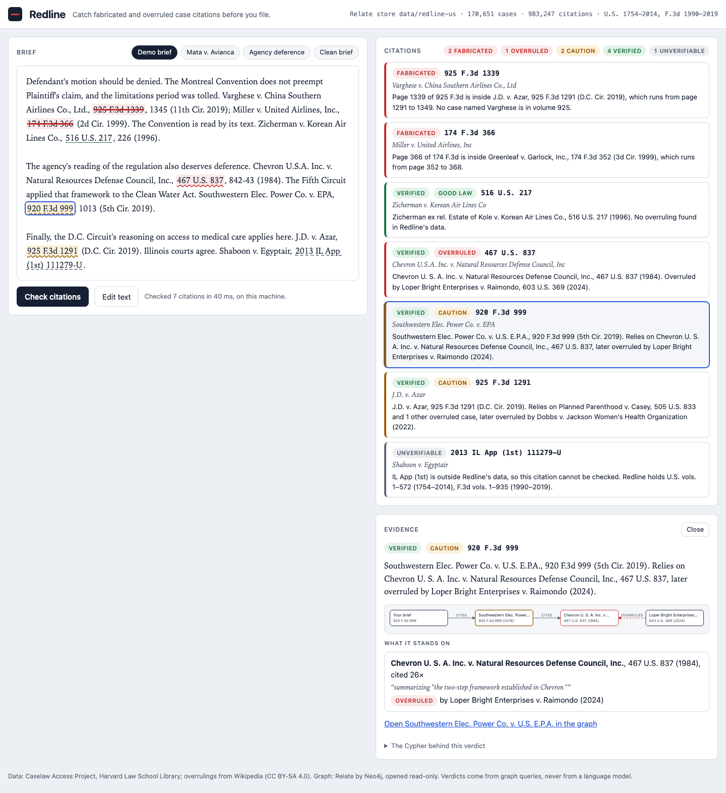

# Redline

Catch fabricated and overruled case citations before you file. Redline checks every citation in a
brief against a citation graph of 170,651 US cases, stored in Relate and running on your machine.



## Use case

Lawyers now file briefs drafted with AI tools, and some of those briefs cite cases that do not exist.
Courts have logged roughly 2,000 such filings. The best-known is *Mata v. Avianca* (S.D.N.Y. 2023),
where the lawyers were sanctioned for citing *Varghese v. China Southern Airlines, 925 F.3d 1339*. A
real citation can also be a problem: the case may have been overruled, or it may rest on a case that
was.

Redline reads a brief and gives each citation one of three verdicts:

| Verdict | Meaning |
|---|---|
| **Fabricated** | The citation cannot be right: the page falls inside a different case, a different case starts on that page, or the reporter series was never published ("982 N.E.4th 701"). Only volumes whose page maps agree with how courts cite them are used as proof. |
| **Verified** | The case exists. Its status is **good law**, **overruled**, or **caution**: it relies on a case that was later overruled. |
| **Unverifiable** | Outside Redline's data. Never called fake. |

For *Varghese*, Redline says: *"Page 1339 of 925 F.3d is inside J.D. v. Azar, 925 F.3d 1291
(D.C. Cir. 2019), which runs from page 1291 to 1349. No case named Varghese is in volume 925."*

The relationships that matter:

- **Volume → case page ranges** prove a fake. A citation is a pointer to a page; the graph knows
  which case owns every page of every volume.
- **Case → cites → case → overruled by → case** shows what a real citation stands on. 9,194 of the
  141,484 appeals-court cases in the store rely on a Supreme Court case that was later overruled:
  4,884 on *Chevron* (overruled by *Loper Bright*, 2024), 1,011 on *Teague v. Lane*, 997 on
  *Saucier v. Katz*, 338 on *Planned Parenthood v. Casey*. Redline flags them as **caution** and shows
  the chain, with the court's own words about the case it relied on.

Every verdict comes from a graph query, and the UI shows the Cypher behind each one. No language
model writes or changes a verdict.

## How it uses Relate

- **Mode: directory.** The store is `data/redline-us/`, opened read-only.
- **Why this mode:**
  - *Persistent and inspectable.* Judges and users get the whole graph in the repo, with no
    download and no server.
  - *Small enough to commit.* The directory store is 51.6 MB of Parquet files, none over 50 MB. The
    same graph written as one `.rl` file measured about eight times larger, because a single file
    keeps the space its write log and earlier snapshots once used (8.6 MB against 73.8 MB for the
    Supreme Court alone). `relate clone data/redline-us redline-us.rl` gives a compact single file
    when one is wanted.
  - *Read-only and local.* A law firm cannot paste a client's draft into a cloud service. Redline
    opens the store read-only in-process and sends nothing anywhere. Tests confirm the store's files
    are byte-for-byte unchanged after checking every test brief.
- **What the graph models:**

```
(:Reporter)-[:HAS_VOLUME]->(:Volume {last_page, order_pages})-[:CONTAINS]->(:Case {first_page, last_page})
(:Case)-[:CITES {weight, parenthetical}]->(:Case)            983,247 citations
(:Case)-[:OVERRULES {partial, topic}]->(:Case)              144 overrulings
(:Case)-[:DECIDED_BY]->(:Court)
(:Citation {text: "93 S.Ct. 705"})-[:CITATION_OF]->(:Case)  parallel citations
```

Coverage: every *United States Reports* case to 2014 (vols. 1–572) and every *Federal Reporter,
Third Series* case (vols. 1–935, 1990–2019). Details, sources and licences: [docs/DATA.md](docs/DATA.md).

Speed on the committed store (Apple Silicon laptop, median of 20 runs): checking a brief takes
17–45 ms; finding every case that rests on *Chevron* takes 1 ms at one hop (5,082 cases), 14 ms at
two (18,224), 86 ms at three (58,574).

## Setup and run

Prerequisites: Python 3.11+ and [uv](https://docs.astral.sh/uv/) (or plain `pip`). No API keys.

```bash
git clone <this repo> redline && cd redline
make setup          # or: python3 -m venv .venv && .venv/bin/pip install -e ".[dev]"
make run            # http://127.0.0.1:8000
```

Open http://127.0.0.1:8000. A sample brief is loaded; press **Check citations**. Click any
citation to see its evidence graph, what it stands on, and the Cypher behind the verdict.

From the command line:

```bash
.venv/bin/redline check tests/fixtures/briefs/mata.txt     # exits 1 if anything is fabricated
.venv/bin/redline check - < my-brief.txt --json
make test                                                 # 51 tests against the committed store
make bench                                                # every benchmark -> docs/BENCHMARK.md
```

As MCP tools for an agent (`check_citations`, `get_case`, `search_cases`, `coverage`):

```bash
claude mcp add redline -- "$PWD/.venv/bin/redline" mcp     # stdio
# or, with `make run` going, point any MCP client at http://127.0.0.1:8000/mcp/
```

HTTP API: `POST /api/check {"text": "..."}`, `GET /api/case/{id}`, `GET /api/search?q=`,
`GET /api/coverage`.

## Where the data lives

`data/redline-us/` is the Relate store, committed to this repo. Inspect it directly:

```bash
# Which case owns the page Varghese claims?
.venv/bin/redline query "MATCH (v:Volume {key:'F3d:925'})-[:CONTAINS]->(c:Case)
  WHERE c.first_page <= 1339 AND c.last_page >= 1339 RETURN c.name, c.court, c.first_page, c.last_page"

# What overruled Roe and Chevron?
.venv/bin/redline query "MATCH (a:Case)-[:OVERRULES]->(b:Case) WHERE b.id IN ['US:410:113','US:467:837']
  RETURN b.name, a.name, a.cite"

# Which overruled cases do appeals courts lean on most?
.venv/bin/redline query "MATCH (c:Case {reporter:'F.3d'})-[:CITES]->(o:Case)<-[:OVERRULES]-(by:Case)
  WHERE by.year >= c.year RETURN o.name, by.name, count(DISTINCT c) AS n ORDER BY n DESC" --limit 10

# What did the Fifth Circuit say when it relied on Chevron?
.venv/bin/redline query "MATCH (c:Case {id:'F3d:920:999'})-[r:CITES]->(o:Case {id:'US:467:837'})
  RETURN c.name, r.weight, r.parenthetical"

# Three hops out from Chevron
.venv/bin/redline query "MATCH (t:Case {id:'US:467:837'})<-[:CITES]-(m:Case) WITH DISTINCT m
  MATCH (m)<-[:CITES]-(n:Case) WITH DISTINCT n MATCH (n)<-[:CITES]-(a:Case) RETURN count(DISTINCT a)"
```

With the Relate CLI installed, `relate --database data/redline-us --read-only` opens the same store.

To rebuild it from the public sources (about 2.4 GB of downloads, then 90 seconds):

```bash
make data           # Caselaw Access Project metadata + Wikipedia's overruling list -> data/redline-us/
make pack           # optional federal pack: adds 1.2M appeals-to-appeals citations (65 MB, not committed)
```

## How well it works

Full method and every number: [docs/BENCHMARK.md](docs/BENCHMARK.md), regenerated by `make bench`.

- **It rarely cries wolf.** On a fresh sample of 495 published opinions it had never seen, its first run
  called 9 of 31,877 real citations fabricated (0.028%); those 9 led to fixes. Across both opinion samples
  (60,431 citations) it now calls none of them fake. Every remaining flag is a citation the digitized text
  really gets wrong, such as `147 F.8d 1344`, where the scan read 3 as 8.
- **It catches what it can prove.** On LePhantomCite (Princeton, 2026), every citation to a reporter series
  that never existed was caught (129 of 129), with no unexplained false alarms on either split. It also
  found 10 real typos in the original briefs that the dataset does not label.
- **It works on real sanctions cases.** Of 86 citations that US courts found fabricated and that fall
  within Redline's data, it proves 47 fake from page evidence alone.
- **It knows its limits.** Agents catch more (GPT-5 found every injected wrong name), but flag 11–25% of
  correct citations. Redline is meant to sit underneath an agent as a tool, not replace it.
- **It audits its own data.** Courts cite 4,056 pages as the start of a case where the Harvard data has
  none, 1,895 of them inside another case. Redline protects those pages and does not use the volumes
  around them as proof.

## Limits

- Coverage ends in 2019 for F.3d and 2014 for the Supreme Court. Later Supreme Court cases appear
  only when the overruling list names them (*Dobbs*, *Loper Bright*).
- State reporters, F. Supp., F.2d, F.4th and Westlaw citations are **unverifiable**: Redline says so
  and never calls them fake, unless the series itself was never published.
- Pages after the last opinion in a volume (order lists, tables of unpublished decisions), short-form
  names it cannot match, and "In re" captions come back **unverifiable**, not fabricated.
- Overrulings come from one curated list of explicit Supreme Court overrulings. Lower-court
  reversals and implicit abrogation are not modelled yet.
- Redline checks that a citation exists and what it stands on. It does not yet check that the case
  says what the brief claims.

## Licence

Code: MIT. Case data: Caselaw Access Project, Harvard Law School Library (released without
restriction). Overrulings: Wikipedia, CC BY-SA 4.0.
